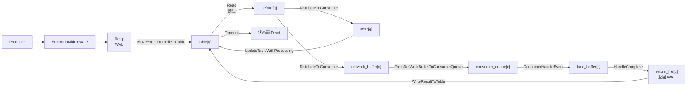

# light-mq

一个用 Go 写的轻量消息队列。按**消息组**投递和消费，入队和返回都走 WAL 批量落库，消费端带去重。

关键路径用 TLA+ 建模验证过，规约在 [`spec/`](./spec/)。

## 为什么做这个

现有的 MQ 都太重，看文档只能知道"有什么"，不知道"为什么这么设计"。

想搞清楚三件事：

- 消息组这种语义，怎么落到代码和表结构里
- 去重表什么时候该清、什么时候该留
- 并发冲突不加锁能不能挡住

顺带把这几条写成规约，用 TLC 跑一遍。

## 核心设计

### 按组投递和消费

组是投递和消费的最小单位。消费者拿到的是一整组，不是单条。这样组内顺序和完整性都有保证，代价是组必须收集齐了才能发。

### WAL + 批量落库

消息来了先写文件，每秒或者攒够一批再落库。返回结果也一样。数据库 QPS 能压到原来的 1/100。

### 消费端去重

接收时检查去重表，组里任何一个 uid 已经在表里就跳过。处理失败时清掉这批 uid，等重发；成功或者进死信则保留。

### 不用锁

同一组从 `Pending` 到终态只会走一次，靠状态机挡：

- 落库时按 uid 逐条 UPDATE，带上状态和 retry 条件，不该写的更新 0 行
- 消费者返回时，只有 `Processing` 才能转终态

## 快速开始

（TODO：代码写完补）

## 架构



消费流程分三段，每段之间隔一个缓冲区：

```
after / network_buffer    中间件发出，还没到消费者
consumer_queue            到了，还没开始处理
func_buffer               正在处理
```

分开是为了让“传输乱序”和“处理乱序”能各自建模。

## 正确性

`spec/MQ.tla` 是 TLA+ 规约，覆盖：

- 入队去重（同一个 uid 不会进两次）
- 按组读取（组不会被拆到两个协程）
- 消费端去重（重复到达不会重复处理）
- 组不分裂（冻结之后，同一组的事件不会分散在两个地方）

2 个队列、2 个消费者、2 个协程、2 个组的配置下跑完：

```
2,830,371,818 states generated
  255,412,835 distinct states found
  depth 86
```

换了两次指纹种子，结果完全一致，基本可以排除指纹碰撞导致的漏状态。

```bash
cd spec
java -cp ~/tla2tools.jar tlc2.TLC -deadlock -config MQ.cfg MQ.tla
```

`spec/MQ.md` 是规约的说明，讲每个动作在做什么、哪些地方简化了。

## 已知限制

- 单机，没有集群和副本
- 没有事务消息
- 窗口和超时靠约定，不保证跨机器时钟严格对齐
- 规约里没有建模窗口的长度，只验证了"超时之后进死信"这个动作本身
- `seq` 在规约里是自增的，表达不出“`end` 之后拒绝更大的 seq”，所以只能证“组不分裂”，证不了“组不再增长”

## 目录

```
.
├── README.md
└── spec/
    ├── MQ.tla      规约
    ├── MQ.cfg      TLC 配置
    └── MQ.md       规约说明
```
