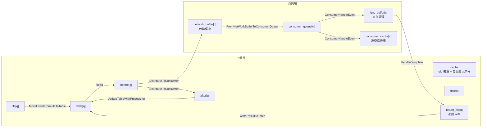
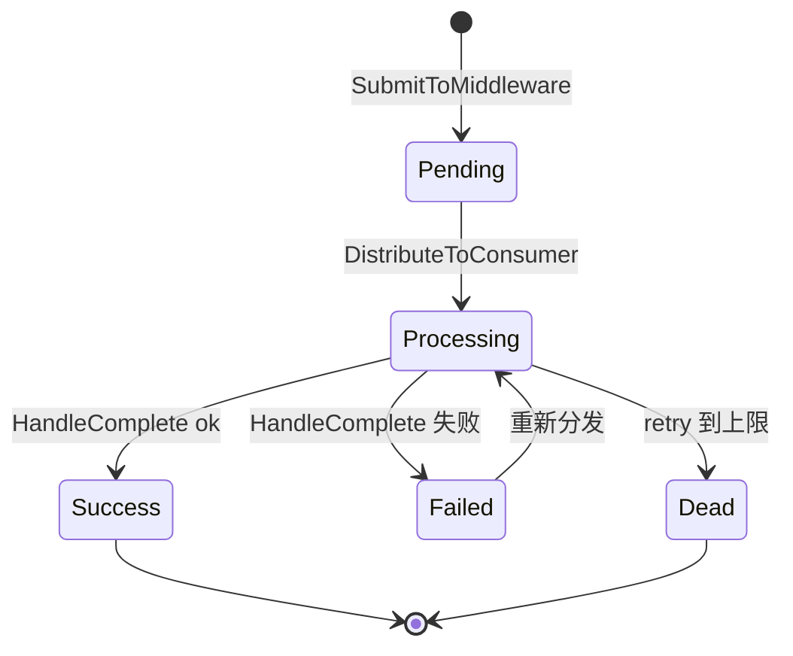

# MQ 规约梳理

对着 `MQ.tla` 整理的。主流程基本齐了，安全性和活性还没写，`Next`、`Spec`、cfg 也还没有。

## 数据结构



| 变量                | 结构                             | 作用                         |
| ------------------- | -------------------------------- | ---------------------------- |
| `file`              | `[q ∈ QUEUE ↦ 事件集合]`         | WAL，还没落库                |
| `table`             | `[q ∈ QUEUE ↦ 事件集合]`         | 数据库                       |
| `cache`             | `[uid ↦ {}, max_event_seq ↦ ⟨⟩]` | 入队去重 + 每组最大序号      |
| `before[g]`         | 集合的集合                       | 分发协程读出来的组           |
| `after[g]`          | 集合的集合                       | 处理完待写回的组             |
| `network_buffer[c]` | 集合的集合                       | 已经"发出"，还没到消费者手里 |
| `consumer_queue[c]` | 集合的集合                       | 到了消费者手里，还没开始处理 |
| `func_buffer[c]`    | 集合的集合                       | 正在处理                     |
| `consumer_cache[c]` | 集合                             | 消费端去重                   |
| `frozen`            | `[⟨queue, group⟩ ↦ uid 集合]`    | 首次出现 end 时的 uid 快照   |
| `uid`               | 自增整数                         | 每条事件一个                 |

四个缓冲区对应三段路：中间件到网络、网络到消费者、消费者正在处理。分开是为了让每一段的乱序能单独建模。

## 一条事件

```tla
[u     ↦ 1‥MAX_UID,
 queue ↦ QUEUE,
 group ↦ GROUPS,
 state ↦ Pending | Processing | Success | Failed | Dead,
 seq   ↦ 1‥MAX_UID,
 retry ↦ 0‥MAX_RETRY,
 end   ↦ BOOLEAN]
```

`retry` 是组级的，拍平之后每条都有，同组可能对不上，但省掉了外键。

事件里的主键字段叫 `u`，不是 `uid`。`uid` 已经是状态变量的名字，TLA+ 里记录字段和变量同名虽然能跑，但会触发警告，读代码也容易混。`cache` 的字段同理，`cache.u` 存的是已经发出过的 uid 集合。

## 消息组状态机



## 动作

| 动作                               | 做什么                                                    |
| ---------------------------------- | --------------------------------------------------------- |
| `SubmitToMiddleware`               | 写 `file`，`cache.uid` 加上新 uid，更新每组最大序号       |
| `MoveEventFromFileToTable`         | `file` 按队列搬进 `table`                                 |
| `Read`                             | 按组读，整组进 `before`                                   |
| `DistributeToConsumer`             | 一组进 `after` 和 `network_buffer`，状态改 `Processing`   |
| `FromNetWorkBufferToConsumerQueue` | 从 `network_buffer` 取一组进 `consumer_queue`             |
| `ConsumerHandleEvent`              | 从 `consumer_queue` 取一组，检查去重，进 `func_buffer`    |
| `HandleComplete` | 从 `func_buffer` 取一组，改状态追加进 `return_file`，失败时清去重 |
| `UpdateTableWithProcessing`        | `after` 按 uid 补进 `table`                               |
| `Freeze`                           | 记组冻结时的 uid 集合                                     |
| `Timeout` | 任意时刻把一组 `Pending` 的事件整体置成 `Dead` |
| `AllEventInTerminal` | 守卫：所有事件都到终态时允许 stutter |

## 三段路，三种乱序

```
before --DistributeToConsumer--> network_buffer   中间件发出
network_buffer --FromNetWorkBuffer...--> consumer_queue   到达消费者
consumer_queue --ConsumerHandleEvent--> func_buffer   开始处理
func_buffer --HandleComplete--> return_file   处理完，先写返回 WAL
```

**传输乱序** 靠 `network_buffer` 和 `consumer_queue` 分开。中间件把组扔进网络，消费者从网络里取，两个动作独立，取出来的顺序可以和发出去的顺序不一样。

**处理乱序** 靠 `func_buffer`。一组进了 `func_buffer` 表示"正在处理"，什么时候出来由 `HandleComplete` 决定，任意时刻都行。

**发送方乱序** 交给上游，规约里用 `∃` 表示"任意一组"。

## 按组读的守卫

`Read` 挑组的时候要同时满足四条：

```tla
∧ event.state ∈ {Pending, Failed}
∧ ∃ end_event ∈ the_group_events: end_event.end = TRUE
∧ ¬(∃ other ∈ GOROUTINES \ {goroutine}:
      the_group_events ∈ before[other] ∨ in_processing ∈ after[other])
∧ in_processing ∉ after[goroutine]
```

前两条是「这组能读」，后两条是「这组不在任何人手里」。

第三条和第四条分开写，是因为 `before` 和 `after` 里存的东西不一样：

```
before   原始状态，Pending
after    改成 Processing 之后的
```

同一个组在两个地方的值不相等，所以 `after` 那边要拿 `in_processing` 去比。

第四条是跑出来的反例补上的。一个协程自己也可能重复读：`before` 里的组被分走之后，`table` 里还是 `Pending`（`UpdateTableWithProcessing` 还没执行），这时再调 `Read`，前三条都满足，又能读一遍。

## 消费端去重

接收的时候检查一次：

```tla
∧ {event.uid: event ∈ event_group} ∩ consumer_cache[consumer] = {}
```

组里每个 uid 都得没在去重表里，才放行。放行之后把这些 uid 写进去。

`HandleComplete` 里分两种情况：

```
成功 / 进死信   去重表保留。重复分发过来会被上面那条挡住
失败            去重表里清掉这些 uid，等重发
```

失败清掉是因为要重试。不清的话，重发过来的那组会被当成"处理过了"，直接丢掉，消息就永远丢了。

## 分发为什么要拆两步

原来 `DistributeToConsumer` 直接把组塞进 `consumer_queue`，发出即到达。这样测不出"同一组被发两次"这种问题，消费端去重也就没东西可验。

拆成：

```
DistributeToConsumer                before -> network_buffer（发出）
FromNetWorkBufferToConsumerQueue    network_buffer -> consumer_queue（到达）
```

到达是独立的 `∃`，顺序可以和发出不一样。

## 返回也攒批

`HandleComplete` 不再直接改 `table`，而是写 `return_file`：

```
HandleComplete        改状态，追加进 return_file
WriteResultToTable    return_file 搬进 table
```

`return_file` 只追加，不删旧的。同一个 uid 可能出现多条，状态不一样。落库的时候靠条件更新挑出正确的那条。

入队和返回都攒批，数据库 QPS 才能真正压下来。只攒一边没用，另一半照样打满。

### 返回的乱序没建模，但实现要防

规约里返回是按顺序到的。真实现不是：

```
失败，清了去重表，发回复 A，网络卡住
重试的事件到达，又处理了一遍，发回复 B，B 先到
B 先写库，A 后到，把 B 的结果覆盖了
```

所以写回必须用条件更新：

```
文件里是 Failed    只能从 Processing 或 Failed 来，而且 retry 要更大
文件里是 Success   终态，无条件写
文件里是 Dead      终态，无条件写
```

`retry` 那条是为了挡住“旧的重试结果覆盖新的”。`Success` 和 `Dead` 互斥，不会再有后续状态，所以优先级最高。

规约里这段乱序没建模，条件更新对应的是 `PickOne`：在内存里按 uid 挑一条，同一 uid 只留一个写。

## 落库的 SQL

### PickOne

内存里按 uid 聚合，每个 uid 只留一条：

```tla
PickOne(S, u) ≜
    IF ∃ e ∈ S: e.u = u ∧ e.state ∈ {Success, Dead}
    THEN CHOOSE e ∈ S: e.u = u ∧ e.state ∈ {Success, Dead}
    ELSE CHOOSE e ∈ S: e.u = u ∧ ¬(∃ f ∈ S: f.u = u ∧ f.retry > e.retry)
```

有终态挑终态，没有就挑 retry 最大的。这一步就是「条件更新」在规约里的对应，落库时每个 uid 只有一行要写。

### 逐条写

最简单，一批消息发 N 条：

```sql
UPDATE domain_events SET state = ?, retry = ?
WHERE uid = ?
  AND state IN ('Processing', 'Failed')
  AND retry < ?;
```

`WHERE uid = ?` 找到那一行，后面两个条件挡住两种不该写的情况：

```
已经是 Success 或 Dead    state IN (...) 不满足
表里的 retry 更大         retry < ? 不满足
```

影响 0 行就跳过，不报错。

### 按状态分组

成功和死信不用比 retry，可以一批一条：

```sql
UPDATE domain_events SET state = 'Success'
WHERE uid IN (?, ?, ...) AND state IN ('Processing', 'Failed');

UPDATE domain_events SET state = 'Dead'
WHERE uid IN (?, ?, ...) AND state IN ('Processing', 'Failed');
```

失败要逐行比 retry，按 retry 分组。`retry` 只可能是 0 到 `MAX_RETRY`，所以最多几条语句：

```sql
UPDATE domain_events SET state = 'Failed', retry = 2
WHERE uid IN (?, ?, ...) AND state IN ('Processing', 'Failed') AND retry < 2;

UPDATE domain_events SET state = 'Failed', retry = 3
WHERE uid IN (?, ?, ...) AND state IN ('Processing', 'Failed') AND retry < 3;
```

### 临时表

还想压成一条语句，就用临时表加 JOIN：

```sql
CREATE TEMPORARY TABLE tmp (
    uid BIGINT PRIMARY KEY,
    retry INT NOT NULL
);

INSERT INTO tmp (uid, retry) VALUES (?, ?), (?, ?), (?, ?);

UPDATE domain_events d
JOIN tmp t ON d.uid = t.uid
SET d.state = 'Failed', d.retry = t.retry
WHERE d.state IN ('Processing', 'Failed') AND t.retry > d.retry;

DROP TEMPORARY TABLE tmp;
```

`UPDATE ... JOIN` 的意思是：两张表按 `uid` 配对，拿临时表的值去改业务表。不是查询，是「一边对一边改」。

`TEMPORARY` 表只在当前连接可见，连接断了自动删。

代价是多两次往返（建表、灌数据），所以只有批量大或者跨机房才值得。

### 怎么选

```
批量小、同机房        逐条 UPDATE
批量大               按状态 / retry 分组
跨机房、极致优化      临时表
```

## 不用加锁

`UpdateTableWithProcessing` 把 `after` 里的 `Processing` 写回表。但表里同一 uid 已经有一行了，入队时插的，所以这是更新不是插入。

一开始写成了「只补表里没有的 uid」：

```tla
event.u ∉ {x.u: x ∈ table[q]}
```

这条是错的。事件本来就在表里，条件永远不成立，一条都插不进去，`Pending` 永远变不成 `Processing`。

正确的写法是按状态挑：

```tla
∧ table' = [q ∈ QUEUE ↦
      LET after_uid ≜ {e.u: e ∈ UNION after[goroutine]}
          in_pending ≜ {e ∈ table[q]: e.state = Pending ∧ e.u ∈ after_uid}
      IN  (table[q] \ in_pending)
          ∪ {[e EXCEPT !.state = Processing]: e ∈ in_pending}]
```

`after` 里的状态一定是 `Processing`，表里的可能是 `Pending`、`Failed`、`Success`、`Dead` 任意一种。`Processing` 只能覆盖 `Pending`。

对应 SQL：

```sql
UPDATE domain_events SET state = 'Processing'
WHERE uid = :uid AND state = 'Pending'
```

影响 0 行说明已经被别人改过，跳过。

加锁是把冲突挡在门外，状态机是把冲突变成「什么都没发生」。

## 冻结（只能证「不分裂」，证不了「不再增长」）

`Freeze` 记组第一次出现 `end` 时的 uid 集合，已经在 `frozen` 里的不覆盖。

`FrozenStable` 验证的是：`frozen` 里记着的组，不管事件走到 `table`、`before`、`after`、`consumer_queue`、`network_buffer` 还是 `func_buffer`，凑出来的 uid 集合都得和快照一样。

**这条管的是「不分裂」，不是「不再变」。**

规约里 `seq` 是自增的，`end` 之后还能继续往这一组里加事件。真实现要靠 `seq <= end_seq` 挡住，加不进来，组才真正冻结。

规约没有建模这个拒绝，所以：

```
能证   end 之后这个组不会被拆到两个地方
不能证 end 之后这个组不再增长
```

第二条要等 `seq` 从参数传进来、并且加上「`end` 之后拒绝更大的 seq」这条守卫，才有意义。现在加了会让状态空间膨胀，先不写。

## 超时

`Timeout` 在任意时刻把一组 `Pending` 的事件整体置成 `Dead`。

条件只有一条，`event.state = Pending`：

```tla
∃ q ∈ QUEUE: ∃ event ∈ table[q]:
    ∧ event.state = Pending
    ∧ LET event_group ≜ {x ∈ table[q]: x.group = event.group}
      IN  table' = [table EXCEPT ![q] =
              (@ \ event_group) ∪ {[e EXCEPT !.state = Dead]: e ∈ event_group}]
```

现实里触发条件是「窗口到了还没收集齐」，规约里没有计时，所以直接允许任意时刻触发。

配套的还有 `SubmitToMiddleware` 开头那条：`table` 里同组已经有 `end` 的话，新消息进不来。没有它，`end` 之后的迟到消息会把已经冻结的组撑大。

配套的是 `MoveEventFromFileToTable` 里那条：

```tla
table' = [x ∈ QUEUE ↦
      LET dead_event ≜ {e ∈ table[x]: e.state = Dead}
          dead_group ≜ {e.group: e ∈ dead_event}
          processed ≜ {IF e.group ∈ dead_group
                       THEN [e EXCEPT !.state = Dead]
                       ELSE e
                       : e ∈ file[x]}
      IN table[x] ∪ processed]
```

`dead_event` 先筛出表里已经死的，`dead_group` 再把这些组的组号取出来，最后对 `file` 里每一条判断要不要跟着死。

每个队列各自算一遍，所以 `[x ∈ QUEUE ↦ ...]` 里面套 `LET`。

如果同组在表里已经死了，`file` 里来的新事件也直接写成 `Dead`。这样新消息进来就跟上组的终态，`ConsistentState` 才成立。

## 活性

```tla
FinalConvergence ≜ ◇□(∀ q ∈ QUEUE: ∀ e ∈ table[q]: e.state ∈ Terminal)
```

最终所有事件都在 `table` 里，而且状态是终态。

这条没有外层量词，`◇□` 直接套状态谓词，最省事。之前写成 `∀ event ∈ table[q]: ◇□(...)` 会报错，因为量词域是变量，TLC 没法把公式编译成自动机。

成立的依赖两个东西：

- 每个动作都有 `WF_vars`，不然它可以一直不被调度
- `Timeout` 能在任意时刻把卡住的组推进 `Dead`

## 对称性

```tla
Symmetry == Permutations(QUEUE) ∪ Permutations(CONSUMER)
          ∪ Permutations(GOROUTINES) ∪ Permutations(GROUPS)
```

队列、消费者、协程、组之间都是对称的，`{Q1, Q2}` 和 `{Q2, Q1}` 在语义上没有区别。

TLC 用这个把对称的状态去重，状态数能降一大截。

注意 `SYMMETRY` 要求的是一个置换群。几个 `Permutations` 直接并起来不一定还是群，得确认这些集合两两不相交，或者用别的方式构造。

cfg 里对应一行：

```
SYMMETRY Symmetry
```

## 去重表只增不减

```tla
CacheMonotonic ≜
    [][∀ u ∈ cache.u: u ∈ cache'.u]_vars
```

入队去重表只加不减，因为 `SubmitToMiddleware` 只往里写。

消费端的 `consumer_cache` 不一样，失败会清，所以没有对应这条。

## 组收齐的简化

规约里只判 `end`，不判序号连续。

简化掉两件事：`end` 之后又来消息的拒绝逻辑、窗口长度。两件都不和主流程纠缠。

## 几个还没落地的点

**`DedupOnlyForLiveOrSuccess` 现在不成立。**

新的竞态：`return_file` 里已经是 `Success`，但还没落库，数据库里这一行还是 `Failed`。这时候别的协程把它读出来处理了一遍。

因为消费者有去重，重复处理不会再产生副作用，实际上没关系。但不变式是按「表里或 WAL 里是终态」写的，这个时间窗口里两边都不是，就被判违反了。

要写准确，得把「还没落库的终态」也算进去，同时考虑各种交错，不是一条短的不变式能覆盖的。先放着。

**`AllEventInTerminal` 有点多余。**

```tla
AllEventInTerminal ≜
    ∧ ∀ q ∈ QUEUE: ∀ event ∈ table[q]: event.state ∈ Terminal
    ∧ UNCHANGED vars
```

它只是「所有事件都终态时允许不动」，而 `[][Next]_vars` 本来就允许 stuttering。放在 `Next` 里不影响正确性，但也没什么用。

**cfg 里的常量是模型值，不是字符串。**

```
QUEUE = {Q1, Q2}
GROUPS = {GR1, GR2}
```

不带引号，`Q1` 是未声明的量，TLC 把它当成模型值。`SYMMETRY` 只能作用在模型值上，换成 `{"Q1", "Q2"}` 这种字符串，置换就不会生效了。

这条不是问题，是必须这么写。留在这里是为了提醒别手贱加引号。

**`Symmetry` 的合法性要确认。**

`Permutations(A) ∪ Permutations(B)` 只有在两个集合不相交的时候才是群。四个并起来如果不满足，TLC 会报错或者静默用错。

## 还没写的

- 活性：`FinalConvergence` 接进 cfg 的 `PROPERTY`
