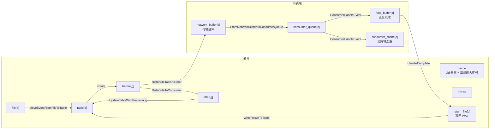
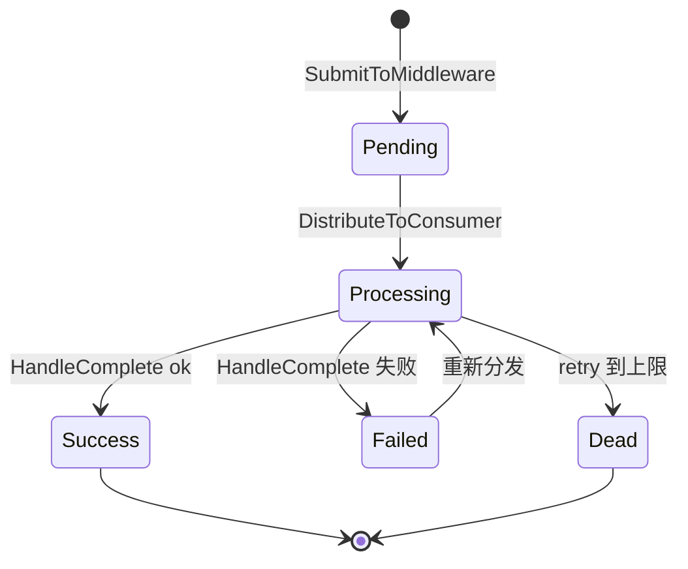

# MQ 规约梳理

对着 `MQ.tla` 整理的。主流程基本齐了，安全性和活性还没写，`Next`、`Spec`、cfg 也还没有。

## 数据结构



| 变量                | 结构                             | 作用                         |
| ------------------- | -------------------------------- | ---------------------------- |
| `file`              | `[q ∈ QUEUE ↦ 事件集合]`         | WAL，还没落库                |
| `table`             | `[q ∈ QUEUE ↦ 事件集合]`         | 数据库                       |
| `cache`             | `[uid ↦ {}, max_event_seq ↦ ⟨⟩]` | 入队去重 + 每组最大序号      |
| `before[g]`         | 集合的集合                       | 分发协程读出来的组           |
| `after[g]`          | 集合的集合                       | 处理完待写回的组             |
| `network_buffer[c]` | 集合的集合                       | 已经"发出"，还没到消费者手里 |
| `consumer_queue[c]` | 集合的集合                       | 到了消费者手里，还没开始处理 |
| `func_buffer[c]`    | 集合的集合                       | 正在处理                     |
| `consumer_cache[c]` | 集合                             | 消费端去重                   |
| `frozen`            | `[⟨queue, group⟩ ↦ uid 集合]`    | 冻结快照                     |
| `uid`               | 自增整数                         | 每条事件一个                 |

四个缓冲区对应三段路：中间件到网络、网络到消费者、消费者正在处理。分开是为了让每一段的乱序能单独建模。

## 一条事件

```tla
[u     ↦ 1‥MAX_UID,
 queue ↦ QUEUE,
 group ↦ 1‥MAX_GROUP,
 state ↦ Pending | Processing | Success | Failed | Dead,
 seq   ↦ 1‥MAX_UID,
 retry ↦ 0‥MAX_RETRY,
 end   ↦ BOOLEAN]
```

`retry` 是组级的，拍平之后每条都有，同组可能对不上，但省掉了外键。

事件里的主键字段叫 `u`，不是 `uid`。`uid` 已经是状态变量的名字，TLA+ 里记录字段和变量同名虽然能跑，但会触发警告，读代码也容易混。`cache` 的字段同理，`cache.u` 存的是已经发出过的 uid 集合。

## 消息组状态机



## 动作

| 动作                               | 做什么                                                    |
| ---------------------------------- | --------------------------------------------------------- |
| `SubmitToMiddleware`               | 写 `file`，`cache.uid` 加上新 uid，更新每组最大序号       |
| `MoveEventFromFileToTable`         | `file` 按队列搬进 `table`                                 |
| `ResubmitToMiddleware`             | 重投，靠 `cache.uid` 拦掉，期望永远不可执行               |
| `Read`                             | 按组读，整组进 `before`                                   |
| `DistributeToConsumer`             | 一组进 `after` 和 `network_buffer`，状态改 `Processing`   |
| `FromNetWorkBufferToConsumerQueue` | 从 `network_buffer` 取一组进 `consumer_queue`             |
| `ConsumerHandleEvent`              | 从 `consumer_queue` 取一组，检查去重，进 `func_buffer`    |
| `HandleComplete` | 从 `func_buffer` 取一组，改状态追加进 `return_file`，失败时清去重 |
| `UpdateTableWithProcessing`        | `after` 按 uid 补进 `table`                               |
| `Freeze`                           | 记组冻结时的 uid 集合                                     |
| `ReDistributeToConsumer`           | 空，只有注释                                              |

## 三段路，三种乱序

```
before --DistributeToConsumer--> network_buffer   中间件发出
network_buffer --FromNetWorkBuffer...--> consumer_queue   到达消费者
consumer_queue --ConsumerHandleEvent--> func_buffer   开始处理
func_buffer --HandleComplete--> return_file   处理完，先写返回 WAL
```

**传输乱序** 靠 `network_buffer` 和 `consumer_queue` 分开。中间件把组扔进网络，消费者从网络里取，两个动作独立，取出来的顺序可以和发出去的顺序不一样。

**处理乱序** 靠 `func_buffer`。一组进了 `func_buffer` 表示"正在处理"，什么时候出来由 `HandleComplete` 决定，任意时刻都行。

**发送方乱序** 交给上游，规约里用 `∃` 表示"任意一组"。

## 消费端去重

接收的时候检查一次：

```tla
∧ {event.uid: event ∈ event_group} ∩ consumer_cache[consumer] = {}
```

组里每个 uid 都得没在去重表里，才放行。放行之后把这些 uid 写进去。

`HandleComplete` 里分两种情况：

```
成功 / 进死信   去重表保留。重复分发过来会被上面那条挡住
失败            去重表里清掉这些 uid，等重发
```

失败清掉是因为要重试。不清的话，重发过来的那组会被当成"处理过了"，直接丢掉，消息就永远丢了。

## 分发为什么要拆两步

原来 `DistributeToConsumer` 直接把组塞进 `consumer_queue`，发出即到达。这样测不出"同一组被发两次"这种问题，消费端去重也就没东西可验。

拆成：

```
DistributeToConsumer                before -> network_buffer（发出）
FromNetWorkBufferToConsumerQueue    network_buffer -> consumer_queue（到达）
```

到达是独立的 `∃`，顺序可以和发出不一样。

## 返回也攒批

`HandleComplete` 不再直接改 `table`，而是写 `return_file`：

```
HandleComplete        改状态，追加进 return_file
WriteResultToTable    return_file 搬进 table
```

`return_file` 只追加，不删旧的。同一个 uid 可能出现多条，状态不一样。落库的时候靠条件更新挑出正确的那条。

入队和返回都攒批，数据库 QPS 才能真正压下来。只攒一边没用，另一半照样打满。

### 返回的乱序没建模，但实现要防

规约里返回是按顺序到的。真实现不是：

```
失败，清了去重表，发回复 A，网络卡住
重试的事件到达，又处理了一遍，发回复 B，B 先到
B 先写库，A 后到，把 B 的结果覆盖了
```

所以写回必须用条件更新：

```
文件里是 Failed    只能从 Processing 或 Failed 来，而且 retry 要更大
文件里是 Success   终态，无条件写
文件里是 Dead      终态，无条件写
```

`retry` 那条是为了挡住“旧的重试结果覆盖新的”。`Success` 和 `Dead` 互斥，不会再有后续状态，所以优先级最高。

规约没建模这段乱序，条件更新也就没写进去。

## 不用加锁

`UpdateTableWithProcessing` 只插表里没有的 uid：

```tla
event.uid ∉ {x.uid: x ∈ table[q]}
```

消费者先写进去的 `Success` 不会被 `Processing` 覆盖。对应 SQL：

```sql
INSERT INTO domain_events (...) VALUES (...)
ON CONFLICT (uid) DO NOTHING
```

加锁是把冲突挡在门外，状态机是把冲突变成"什么都没发生"。

## 冻结

`Freeze` 记组第一次出现 `end` 时的 uid 集合，已经在 `frozen` 里的不覆盖。

`FrozenStable` 验证：`frozen` 里记着的组，不管事件走到哪，凑出来的 uid 集合都得和快照一样。

## 组收齐的简化

规约里只判 `end`，不判序号连续。

简化掉两件事：`end` 之后又来消息的拒绝逻辑、窗口长度。两件都不和主流程纠缠。

## 待改

**还差一个「判定整组死信」的动作。**

要能在任意时刻把某一组整体置成 `Dead`。触发条件大概是“组里有 Pending 的消息，但等不到 `end`”。

配套的还有：判定之后，这个组新来的消息应该直接置 `Dead`，不再进正常流程。所以在 `SubmitToMiddleware` 里要加一条判断，同组已有 `Dead` 就直接跟着死。

**`ReDistributeToConsumer` 现在是时序公式。**

```tla
[][∃ c ∈ CONSUMER: ∃ u ∈ consumer_cache[c]: TRUE => u ∈ consumer_cache'[c]]_vars
```

它断言的是“去重表只增不减”，不是动作。要么改成不变式，要么改成真动作，等你想清楚放哪。

## 还没写的

- `Next` 和 `Spec`
- 安全性：`FrozenStable`、去重、状态单调
- 活性：每个组最终收敛到 `Success` 或 `Dead`
- `ReDistributeToConsumer`
- cfg
